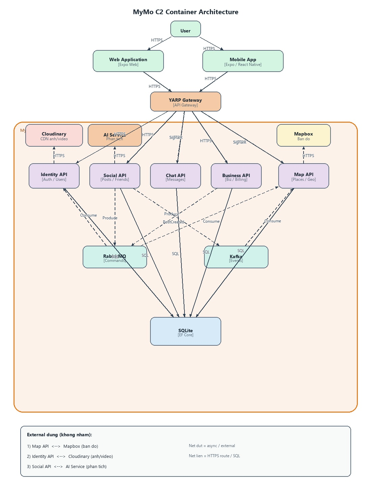

# MyMo Backend (`mymo-be`)

Nền tảng **Mạng xã hội Bản đồ Thời gian thực & Khám phá Địa điểm (Location-Based Social Network & O2O Local Business Platform)** được xây dựng trên nền tảng **.NET 8 Microservices** kết hợp kiến trúc **3-Layer (API – BLL – DAL)**.



---

## 1. Kiến trúc Hệ thống (System Architecture)

Hệ thống bao gồm **1 API Gateway (YARP)** và **5 Microservices độc lập** theo mô hình **Database-per-Service**:

| Service | Port | Database | Trách nhiệm chính |
| :--- | :---: | :--- | :--- |
| **Mymo.Gateway** | `5079` | — | Cổng định tuyến tập trung (YARP Reverse Proxy) cho REST API & SignalR WebSockets |
| **Mymo.Identity** | `5001` | `mymo_identity.db` | Xác thực JWT/OTP, Hồ sơ người dùng, Vị trí trực tuyến, Admin Portal, Reports & Audit Logs |
| **Mymo.Social** | `5002` | `mymo_social.db` | Bảng tin (Feed/Archive), Tương tác (Like/Comment/View), Kết bạn/Chặn, Thông báo, AI Hana |
| **Mymo.Map** | `5003` | `mymo_map.db` | Bản đồ địa điểm theo Vibe, Đánh giá sao, Check-in (Mood/Weather), Thời tiết, `MapHub` |
| **Mymo.Chat** | `5004` | `mymo_chat.db` | Hội thoại & Nhắn tin 1-1 thời gian thực qua SignalR `ChatHub` |
| **Mymo.Business** | `5005` | `mymo_business.db` | Hồ sơ Chủ quán (B2B), Menu, Khuyến mãi, Gói dịch vụ, Đơn Premium & Quảng cáo VietQR |

### Cơ chế Giao tiếp Đa luồng (Hybrid Communication)
1. **Đồng bộ (Internal HTTP)**: Các Microservice gọi qua lại bằng `HttpClient` được bảo vệ bởi Header `X-Internal-Key`.
2. **RabbitMQ (Command Bus)**: Xử lý các mệnh lệnh nghiệp vụ liên service (`identity.commands.set-role`, `identity.commands.set-premium`, `identity.commands.create-report`, `map.commands.update-place-ad`).
3. **Apache Kafka (Event Bus) + SignalR**: Phát tán sự kiện `mymo.social.post-created` từ `Social` sang `Map` để đẩy thông báo bài viết mới lên bản đồ theo thời gian thực qua `MapHub`.

---

## 2. Hướng dẫn Khởi chạy (Getting Started)

### Cách 1: Chạy trực tiếp bằng .NET 8 CLI (Nhanh, không cần Docker)
Yêu cầu: Máy đã cài đặt **.NET 8 Runtime / SDK**.

```powershell
# 1. Build toàn bộ solution
dotnet build Mymo.slnx --configuration Release

# 2. Khởi chạy đồng thời cả 6 services (Identity, Social, Map, Chat, Business, Gateway)
.\scripts\run-dotnet.ps1
```

### Cách 2: Chạy bằng Docker Compose (Đầy đủ RabbitMQ & Apache Kafka)
1. Sao chép file `.env.example` thành `.env` và điền các khóa bí mật (`MYMO_JWT_SECRET`, `MYMO_INTERNAL_KEY`, `MYMO_RABBITMQ_PASSWORD`).
2. Chạy script khởi động:
```powershell
.\scripts\start-local.ps1
```

---

## 3. Tài khoản Mẫu (Pre-seeded Demo Accounts)

Khi khởi động lần đầu, hệ thống tự động nạp dữ liệu mẫu (Seed Data) với 3 tài khoản đại diện cho 3 vai trò:

| Vai trò (Role) | Email | Mật khẩu | Mô tả |
| :--- | :--- | :--- | :--- |
| **User (B2C)** | `demo@mymo.app` | `Demo123!` | Người dùng trải nghiệm bản đồ, đăng bài, check-in, kết bạn |
| **Business (B2B)** | `business@mymo.app` | `business123` | Chủ sở hữu quán mẫu **Cafe Momo** (Nguyễn Huệ & Đường Sách) |
| **Admin** | `admin@mymo.app` | `admin123` | Quản trị viên duyệt quán, xác nhận VietQR, xử lý báo cáo |

---

## 4. Kiểm thử Tự động (Automated Testing)

Dự án cung cấp cả bộ **Unit/BLL Tests** và **API Smoke Tests**:

```powershell
# Chạy Unit & Business Logic Tests
dotnet run --project tests/Mymo.Tests/Mymo.Tests.csproj

# Chạy kịch bản kiểm thử tích hợp API qua Gateway (http://localhost:5079)
.\scripts\test-apis.ps1
```

Xem thêm chi tiết thiết kế lớp và cơ sở dữ liệu tại [docs/ARCHITECTURE_AND_DATABASE.md](docs/ARCHITECTURE_AND_DATABASE.md).

